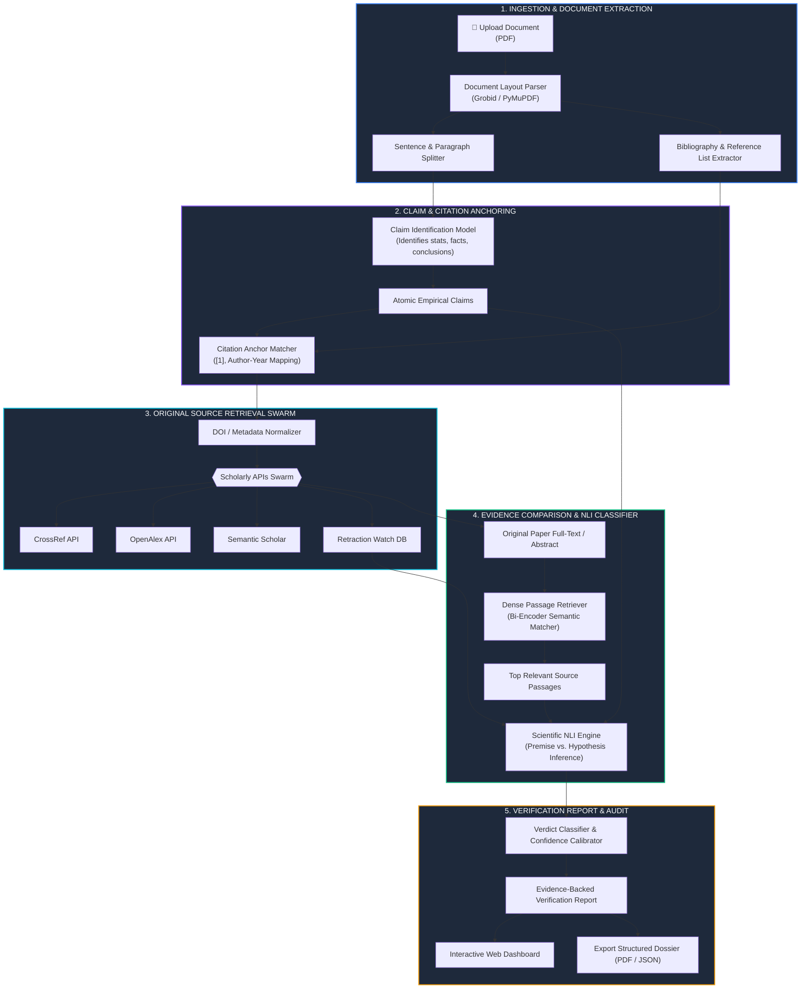
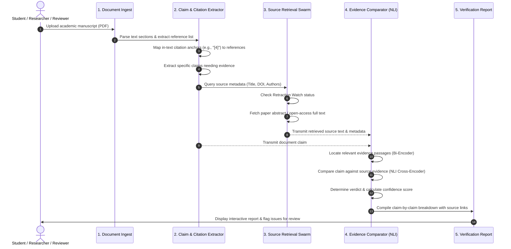

# 🔬 CiteVerify
### Scientific Claim & Citation Verification Engine

`Problem Statement: 03 CiteVerify` • `Domain: Research Tech & Academic Integrity` • `Verification: 5-Tier Explainable Taxonomy` • `Compliance: Human-In-The-Loop Audit` • `Hackathon: INNOVEDGE 2026`

> **CiteVerify** is an intelligent, evidence-grounded academic verification platform that audits scientific papers, extracts claims and citation anchors, retrieves original literature via DOIs/scholarly APIs, and checks whether cited sources genuinely prove what authors claim.

---

## 📌 Table of Contents
- [🎯 The Challenge & Mission](#-the-challenge--mission)
- [✨ Core Capabilities](#-core-capabilities)
- [🏗️ System Architecture](#️-system-architecture)
- [🔄 Verification Workflow](#-verification-workflow)
- [⚖️ 5-Tier Claim Status Taxonomy](#️-5-tier-claim-status-taxonomy)
- [🔬 Interactive Verification Result Anatomy](#-interactive-verification-result-anatomy)
- [🌐 Multi-Corpus Retrieval Swarm](#-multi-corpus-retrieval-swarm)
- [🛠️ Tech Stack](#️-tech-stack)
- [🛡️ Build for Academic Trust: Guiding Principles](#️-build-for-academic-trust-guiding-principles)
- [🔮 Future Scope](#-future-scope)

---

## 🎯 The Challenge & Mission

### The Problem
In academic writing, students, researchers, and reviewers rely on citations to validate empirical statements. However:
- **Misleading References**: A reference may be genuine, but the cited paper does not actually prove or even discuss the specific claim.
- **Scope Creep & Exaggeration**: Authors often generalize small in vitro or pilot studies into sweeping universal claims.
- **Outdated / Retracted Works**: Papers cite superseded literature or studies flagged on Retraction Watch.
- **The Manual Verification Bottleneck**: Reviewing dozens of references across 40-page papers manually is exhausting, leaving unsupported claims undetected.

### The Mission
> **Build for Academic Trust:** *"A citation is not proof by itself."*  
> CiteVerify inspects academic documents, isolates empirical claims and their corresponding citation markers (`[1]`, `(Smith et al., 2022)`), retrieves the original source texts, and verifies whether the original findings substantiate, partially support, or contradict the assertions made.

---

## ✨ Core Capabilities

| Capability | Functionality |
| :--- | :--- |
| **📑 Document & Claim Extraction** | Parses PDF papers to extract testable claims, statistics, percentages, and methodological findings. |
| **🔗 Citation Detection & Mapping** | Resolves in-text markers (`[1]`, `[12-15]`, Author-Year) and links them precisely to entries in the bibliography. |
| **🔎 Original Paper Retrieval** | Queries scholarly indexes (CrossRef, OpenAlex, Semantic Scholar, arXiv, PubMed) via DOI, title, and authors. |
| **📊 Evidence Passage Extraction** | Employs dense passage retrieval to locate the exact paragraphs, result tables, and caveats inside the original paper. |
| **⚖️ Claim Status Classification** | Categorizes claims into a 5-tier explainable taxonomy (Supported, Partly Supported, Unsupported, Contradictory, Needs Human Review). |
| **🚩 Misleading Reference Detection** | Flags ghost citations, circular references, paper-mill patterns, and mismatched claims. |
| **🔍 Evidence & Source Traceability** | Displays side-by-side claim vs. source passage, page number, and direct external DOI links. |
| **📋 Auditable Verification Report** | Exports a structured, calibrated report with confidence indicators for human reviewers. |

---

## 🏗️ System Architecture

CiteVerify is built as a modular, end-to-end pipeline combining natural language processing, scholarly API integrations, and natural language inference (NLI):



---

## 🔄 Verification Workflow

The end-to-end lifecycle of a verification scan:



---

## ⚖️ 5-Tier Claim Status Taxonomy

CiteVerify replaces binary "true/false" checks with an explainable, 5-state academic taxonomy:

| Status | Badge | Criteria |
| :--- | :--- | :--- |
| **Supported** | 🟢 **SUPPORTED** | Source directly confirms claim data, metrics, and causal direction. |
| **Partly Supported** | 🟡 **PARTIAL** | General premise is mentioned, but figures differ, or scope is magnified. |
| **Unsupported** | 🔴 **NO PROOF** | Cited paper makes no mention of the specific claim or numbers asserted. |
| **Contradictory** | 🟣 **CONFLICT** | Source paper's findings directly refute or contradict the author's statement. |
| **Needs Human Review** | 🟠 **HUMAN REVIEW** | Paywalled source, nuanced context, or ambiguous evidence requiring manual expert inspection. |

---

## 🔬 Interactive Verification Result Anatomy

Every analyzed claim produces a structured, transparent result card:

```text
┌──────────────────────────────────────────────────────────────────────────────┐
│ CLAIM AUDIT REPORT #042                               [ VERDICT: PARTIALLY SUPPORTED ]│
├──────────────────────────────────────────────────────────────────────────────┤
│ 📝 UPLOADED DOCUMENT CLAIM:                                                  │
│ "A particular study found that an AI-driven learning app improved test       │
│  scores by 30%."                                                             │
├──────────────────────────────────────────────────────────────────────────────┤
│ 📚 MATCHED CITATION:                                                         │
│ [4] Sharma et al. (2023), "Adaptive Interfaces in Classrooms",               │
│     Journal of EdTech, DOI: 10.1016/j.jedtech.2023.04.012                   │
├──────────────────────────────────────────────────────────────────────────────┤
│ 🔍 RELEVANT SOURCE EVIDENCE:                                                 │
│ "The pilot cohort demonstrated improved engagement. However, summative test  │
│  scores showed a modest 4.2% increase across the sample (n=30), which did    │
│  not achieve statistical significance (p=0.07)." (Section 4, Page 8)         │
├──────────────────────────────────────────────────────────────────────────────┤
│ 💡 EXPLANATION:                                                              │
│ The source paper discusses score improvement, but records only a 4.2%        │
│ change in a small pilot group. The asserted 30% metric is NOT supported by   │
│ the cited paper.                                                             │
├──────────────────────────────────────────────────────────────────────────────┤
│ 📊 CONFIDENCE: 92% (High Confidence)   | 🔗 SOURCE TRACE: [https://doi.org/](https://doi.org/)... │
│ 🚩 FLAG: Needs Human Review (Metric discrepancy detected)                     │
└──────────────────────────────────────────────────────────────────────────────┘
```

---

## 🌐 Multi-Corpus Retrieval Swarm

CiteVerify queries a resilient federation of academic data providers:

```text
                  ┌────────────────────────┐
                  │ Citation Query / DOI   │
                  └───────────┬────────────┘
                              │
      ┌───────────────────────┼───────────────────────┐
      ▼                       ▼                       ▼
┌──────────────┐        ┌──────────────┐        ┌──────────────┐
│   CrossRef   │        │   OpenAlex   │        │Semantic Schol│
│  (Metadata,  │        │ (Open Access │        │(Citation Net,│
│  DOI links)  │        │  Full-Text)  │        │ TLDR graphs) │
└──────┬───────┘        └──────┬───────┘        └──────┬───────┘
       │                       │                       │
       └───────────────────────┼───────────────────────┘
                               ▼
                ┌────────────────────────────┐
                │ Retraction Watch Sentinel  │
                │ (Flag Retracted Papers)    │
                └─────────────┬──────────────┘
                              ▼
                ┌────────────────────────────┐
                │ Full-Text / Abstract Cache │
                └────────────────────────────┘
```

---

## 🛠️ Tech Stack

- **Frontend / UI**: TypeScript, React / Next.js (Tailwind CSS)
- **Backend & Database**: Supabase (PostgreSQL, Edge Functions, Storage)
- **Document & Claim Processing**: PDF Parsing, NLP & Natural Language Inference (NLI)
- **Scholarly APIs**: CrossRef REST API, OpenAlex API, Semantic Scholar API


---

## 🛡️ Build for Academic Trust: Guiding Principles

CiteVerify is engineered around strict ethical safeguards for academic integrity:

1. **A Citation is Not Proof**: Having a bibliography does not validate a paper; the evidence must back the text.
2. **Explainable Findings**: Every automated flag presents the verbatim source passage, the matched DOI, and the reason for the discrepancy.
3. **Calibrated Confidence**: Confidence indicators reflect evidence strength and uncertainty—never an absolute mathematical guarantee.
4. **Human-in-the-Loop**: CiteVerify serves as an intelligent co-pilot for students, researchers, and reviewers. Findings are open for human verification and contextual judgment.

---

## 🔮 Future Scope

- **Overleaf & Word Add-in**: Real-time citation verification as researchers write.
- **Cascading Citation Tracker**: Detect citation distortion chains across multiple generations of cited papers.
- **Predatory Journal Detection**: Automatically flag citations from unindexed or predatory publishers.
- **Multi-Lingual Paper Verification**: Verify non-English academic literature and cross-lingual citations.

